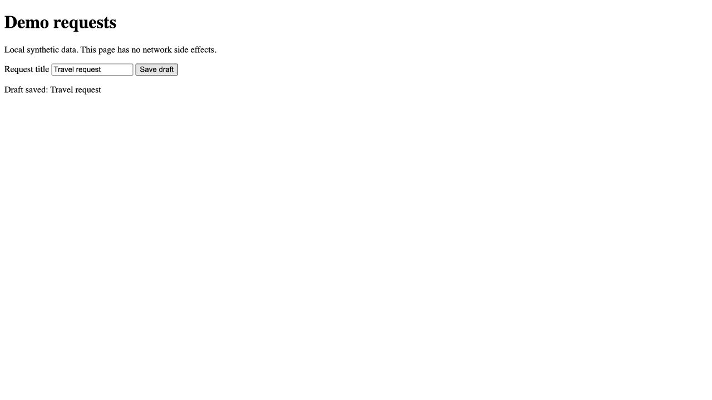

# Save a draft in Demo requests

Audience: a user of the local synthetic demo. Browser-observed on 2026-11-07 at
`http://127.0.0.1:8765/` in the ChatGPT in-app browser. No sign-in was present.

1. Open the demo page. Confirm the heading **Demo requests**, the **Request title**
   field, and the **Save draft** button.
2. Enter `Travel request` in **Request title**.
3. Select **Save draft**. The page displays **Draft saved: Travel request**.



The screenshot is an actual capture of step 3 with synthetic data. The browser's
accessibility state also reported the exact success text after the action.
No screenshots were fabricated or redacted. Only this success journey was
observed; empty-input validation, persistence after reload, account roles, and
recovery paths were not verified. This demo guide makes no claim about a real
production application.

To serve the fixture locally from the repository root:

```sh
python3 -m http.server 8765 --bind 127.0.0.1 --directory tests/fixtures/manual
```
